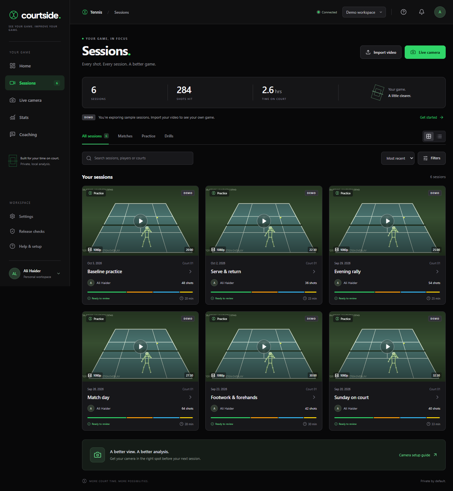

# Courtside

Courtside is a local tennis coaching workspace. It combines a React app, a FastAPI server, a SQLite job queue, and MediaPipe pose analysis to review recorded sessions or follow a live camera feed. Recordings and model files stay on the machine running the server.



**Current status:** Local evaluation MVP. Demo sessions are synthetic, and the shot classification and coaching results have not been validated on real matches. Live feedback is labeled experimental. Offline coaching tips remain disabled until a qualified coach approves the rules.

## Get started on Windows

Install Python 3.11 and Node.js 22, then run these commands from the repository root:

```powershell
py -3.11 -m venv .venv
.\.venv\Scripts\Activate.ps1
python -m pip install -c requirements.lock -e '.[vision,dev]'
npm ci
python data/download_model.py
npm run build
courtside doctor
courtside serve
```

Open [Courtside](http://127.0.0.1:8000/#sessions). The server starts the API and its background worker; the built frontend is served on the same port. Keep the terminal open while using the app.

On Linux or macOS, create the environment with `python3.11 -m venv .venv` and activate it with `source .venv/bin/activate`, then run the remaining commands above. On Debian or Ubuntu, MediaPipe also needs system graphics libraries such as `libegl1` and `libgles2`.

For frontend development, keep `courtside serve` running and run `npm run dev` in a second terminal. Vite opens at `http://127.0.0.1:5173` and proxies `/api` to the backend.

## Use Courtside

- **Sessions:** Sign in, open **Sessions**, then choose **Import video** to upload an MP4 or MOV. Confirm processing permission for everyone in the recording. Junior sessions also require guardian consent and player assent. Analysis produces a report, annotated video, shot clips, and measurements.
- **Live camera:** Open [Live camera](http://127.0.0.1:8000/#live), choose a browser camera, confirm processing permission, and start the feed. Live frames are processed in memory and are not recorded. A phone camera accessed over a network needs a trusted HTTPS connection; see [deployment](docs/deployment.md).
- **Match review:** In a completed session, open **Match & highlights** to keep score from confirmed point winners, review provisional line estimates, select rally candidates, and export private highlight clips. Scoring does not determine winners automatically, and line estimates are not officiating-grade calls. See [match tools](docs/match-tools.md).
- **Apple Watch:** Source for an iPhone and paired Watch companion is in [native/apple](native/apple/README.md). It still needs a Mac build, signing, and device testing.

The [interface guide](docs/tennis-interface.md) explains the screens and remaining feature limits. The [camera guide](docs/camera_setup.md) covers placement and lighting.

## Accounts and privacy

Sign-in is required by default. Create the first password account on the server's localhost page, or [configure Google sign-in](docs/google-signin.md) so each Google user can create an account at first login. Every account has its own storage, session feed, reports, media, and match data. Even an administrator cannot open another user's workspace in personal mode. Existing recordings in the former shared `storage/` workspace are preserved separately and are not automatically assigned to an account.

For public access, set `COURTSIDE_ENV=production` and an HTTPS `COURTSIDE_ORIGIN`, then run the server on loopback behind a trusted HTTPS reverse proxy. The app uses secure, HTTP-only session cookies and checks CSRF tokens for changes. See [Google setup](docs/google-signin.md) and [deployment](docs/deployment.md). `.env.example` lists the settings; the CLI does not load `.env` automatically. Never commit credentials, recordings, SQLite databases, or model weights.

## Command-line analysis

```powershell
courtside analyze session.mp4 --out out\session
courtside stream session.mp4 --out out\stream
```

`analyze` produces the report, pose and ball tracks, annotated video, poster, and shot clips. `stream` benchmarks a video file as simulated live input; it is not a camera service. Run `courtside --help` for options.

## Training and checks

The bundled pose task is a general model, and the active shot labels use motion heuristics. Train a candidate classifier only with consented, reviewed sessions and independent train, validation, and test splits; see [training](docs/training.md). The external tennis dataset workflows and their experimental baseline results are described in [dataset setup](docs/dataset_setup.md) and [external training](docs/external_training.md). Those baselines are not active in the app.

From the activated environment, run:

```powershell
python -m pytest --cov --cov-report=term-missing
python -m ruff check src api worker tests eval
python -m mypy src/courtside api worker
npm test
npm run build
```

Python coverage must stay at or above 85%. The real-model tests require `python data/download_model.py`. GitHub CI checks Windows and Linux. See the [QA report](docs/qa_report.md) and [known issues](docs/known_issues.md) for current evidence and limits.

This repository is not yet cleared for a public or commercial release. It still needs held-out tennis evaluation, qualified coach review, privacy and licensing review, and target-host backup and HTTPS checks. The [architecture](docs/architecture.md) and [release status](eval/status.md) give more detail.
